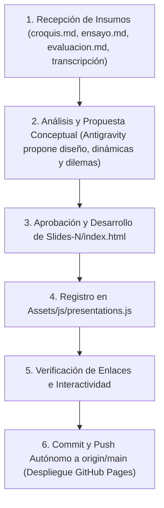

# 🧠 GEMINI.MD — Manual de Operaciones y Contexto Obligatorio
> **ESTE ARCHIVO DEBE SER CONSULTADO OBLIGATORIAMENTE AL INICIO DE CADA SESIÓN Y ANTES DE EJECUTAR CUALQUIER TAREA EN ESTE REPOSITORIO.**

---

## 1. Identidad del Proyecto y Participante
- **Participante:** Julio Vera  
- **Cédula de Identidad:** V-26.889.534  
- **Usuario de GitHub:** `julioverx`  
- **Repositorio Remoto:** `https://github.com/julioverx/presentaciones.git`  
- **URL de Producción (GitHub Pages):** `https://julioverx.github.io/presentaciones/`  
- **Institución:** Universidad Nacional Experimental Simón Rodríguez (UNESR)  
- **Dependencia:** Decanato de Postgrado y Educación Avanzada — Núcleo Apure  
- **Programa:** Maestría en Ciencias Administrativas: Gerencia del Talento Humano  
- **Sede / Ubicación Oficial:** Biruaca, Estado Apure, Venezuela  

---

## 2. Regla de Oro: Estructura de la Portada (Slide 1 / Ejemplo)
Cualquier presentación creada **DEBE** respetar milimétricamente la estructura definida en los archivos de referencia `Assets/Ejemplo` (`.pdf`, `.svg`, `.png`):

1. **Logo institucional:** Ubicado arriba a la izquierda (`Assets/Logo.svg`). Su color o filtro se adapta a la paleta cromática de la presentación (fondos con plexus, desenfoques, efectos glassmorphism, modo claro u oscuro).
2. **Membrete superior:**
   ```text
   REPÚBLICA BOLIVARIANA DE VENEZUELA
   UNIVERSIDAD NACIONAL EXPERIMENTAL SIMÓN RODRÍGUEZ
   DECANATO DE POSTGRADO Y EDUCACIÓN AVANZADA — NÚCLEO APURE
   MAESTRÍA EN CIENCIAS ADMINISTRATIVAS: GERENCIA DEL TALENTO HUMANO
   CURSO: [NOMBRE DE LA ASIGNATURA]
   ```
3. **Título y subtítulo en el centro:** Título destacado con peso tipográfico alto (bold/black) y subtítulo explicativo inmediatamente abajo.
4. **Créditos académicos (debajo del título):**
   - **Facilitador(a):** Nombre y título (ej. *Dra. Yennis Sarmiento*).
   - **Participante:** `JULIO VERA | V-26.889.534`.
5. **Pie de portada:**
   - **Lugar y Fecha:** `BIRUACA, [MES] DE [AÑO]` (ej. `BIRUACA, NOVIEMBRE DE 2026`).
6. **Tipografía obligatoria:** **Figtree** (Google Fonts) en todos los títulos, subtítulos, membretes y textos del proyecto.

---

## 3. Organización Estricta de Carpetas

```text
Diapositivas/
├── gemini.md                              # 🧠 Este archivo de contexto y protocolo permanente
├── index.html                            # 🏛️ Landing Page / Hub principal de presentaciones
├── README.md                             # 📖 Documentación pública
├── .gitignore                            # 🚫 Filtros de Git
├── Assets/
│   ├── Logo.svg                          # 🏛️ Logo oficial UNESR
│   ├── Ejemplo.svg / .pdf / .png         # 📐 Referencia visual oficial de portada
│   ├── css/
│   │   ├── main.css                      # Estilos del portal hub
│   │   └── slide-framework.css           # Framework visual de diapositivas 16:9
│   └── js/
│       ├── presentations.js              # Catálogo centralizado de presentaciones
│       └── slide-engine.js               # Motor de navegación, teclado y fullscreen
│
├── Transcripciones/                      # 🎙️ Transcripciones de clases grabadas (formato .md)
│   ├── Etica-de-la-Profesion/
│   │   └── Clase-01.md
│   └── Teorias-de-la-Administracion/
│       └── Clase-01.md
│
└── Proyectos/                            # 📂 Carpetas por materia
    ├── Etica-de-la-Profesion/
    │   └── Slides-1/                     # 🎯 Presentación específica
    │       ├── index.html                # Código de la presentación interactiva
    │       ├── croquis.md                # Esquema slide por slide proporcionado por Julio
    │       ├── ensayo.md                 # Ensayo o monografía base en Markdown
    │       └── evaluacion.md             # Plan de evaluación y rúbrica de la facilitadora
    └── Teorias-de-la-Administracion/
        └── Slides-1/
            ├── index.html
            ├── croquis.md
            └── evaluacion.md
```

---

## 4. Protocolo Autónomo de Git (Sin intervención del usuario)
- **El usuario NO ejecuta comandos de Git.** Antigravity asume el 100% de la responsabilidad de control de versiones.
- Cada vez que se cree, actualice o modifique una diapositiva o documento:
  1. `git add .`
  2. `git commit -m "tipo: descripción clara del cambio"`
  3. `git push origin main`
- En caso de necesitar `git pull`, se procede con la autorización pre-otorgada por el usuario.

---

## 5. Roadmap / Flujo de Trabajo para Cada Presentación



### Fases Detalladas:
1. **Fase de Insumos:**
   - Julio entrega el `croquis.md` (distribución de lo que quiere en la slide 1, slide 2, etc.).
   - Julio aporta el texto base (`ensayo.md`, `monografia.md`) y el plan de evaluación de la docente (`evaluacion.md`).
   - Si existen transcripciones de audio de clase (`.md`), se consultan en `Transcripciones/[Materia]/`.
2. **Fase de Propuesta e Interactividad:**
   - Antigravity analiza el contenido académico y la rúbrica docente.
   - Se proponen elementos dinámicos acordes al tema (ej: efectos plexus con canvas o SVG, tarjetas de dilemas éticos con feedback instantáneo, comparativas visuales, gráficos o diagramas interactivos).
3. **Fase de Construcción:**
   - Creación de `index.html` dentro de `Proyectos/[Materia]/Slides-[N]/`.
   - Garantizar la Portada Estándar UNESR en la diapositiva 1.
   - Inclusión del motor `SlideEngine` y atajos de teclado (`F`, `O`, `Esc`, `Espacio`, `?`).
4. **Fase de Catálogo:**
   - Registrar la presentación en `Assets/js/presentations.js` con tags, autor, facilitador y enlaces.
5. **Fase de Publicación:**
   - Subida automática a GitHub para renderizado inmediato en GitHub Pages.

---

## 6. Preferencias de Formato de Documentos
- **Siempre Markdown (`.md`):** Tanto para transcripciones de audio como para ensayos y rúbricas. El formato `.md` permite indexar rápidamente encabezados, diálogos con timestamps, citas de la docente y conceptos clave.
- **Tipografía:** Siempre Figtree (`font-family: 'Figtree', sans-serif`).
- **Aspect Ratio:** Siempre 16:9 (`slide-canvas`).
